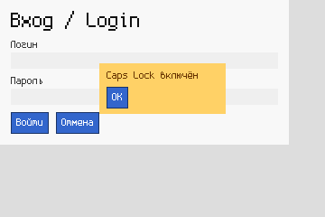
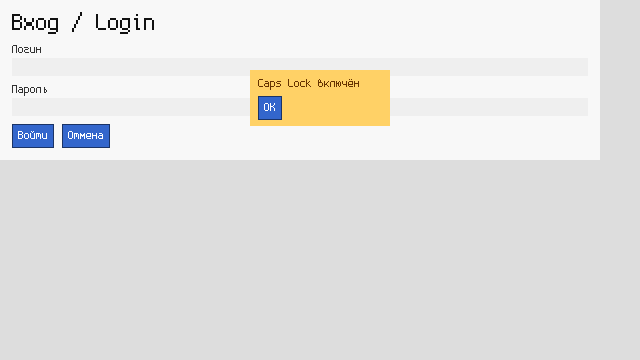

# Машинный (`mash`)

**Машинный** — язык программирования, рассчитанный на то, что код пишет и читает ИИ. Результат любой программы можно точно предсказать до запуска.

Автор идеи — Иван Воронцов. Код, документация и тесты сделаны с помощью ИИ.

## Чем он лучше обычных языков для ИИ
| Свойство | Машинный | Python / JS |
|---|---|---|
| Главная форма | канонический бинарный `.pnb`: одна программа — одна последовательность байтов | текст с произвольным форматированием |
| Хеш кода | `hash`, `semantic_hash` (не зависит от имён локальных переменных) и хеш каждой функции | нет |
| Завершение | всегда: рекурсия только с мерой `dec` (доказывается Z3) плюс лимит шагов | может зависнуть |
| Детерминизм | нет UB, нет неупорядоченных коллекций, длинные целые, деление на ноль — именованная ловушка | порядок `set` зависит от `PYTHONHASHSEED` |
| Эффекты | явные (`!io`), при предсказании только записываются | любые и где угодно |
| Предсказание | `mash predict`: значение, точное число шагов и журнал эффектов | только запуск |
| Контракты | `pre`, `post` и `dec` доказываются Z3, при неудаче выдаётся контрпример | нет |
| Ошибки | JSON с `code`, `path`, `at`, `expected`, `got`, `fix` | текст и трассировка стека |
| Генерация | готовая GBNF-грамматика и JSON-схема AST для ограниченной генерации | нет |
| Интерфейс | детерминированная раскладка и растеризация: известны точная рамка каждого элемента, перекрытия, кто получит клик и PNG с хешем | зависит от системы, шрифтов и DPI |

## Установка
```
pip install z3-solver
python -m mash --help
```
Готовый бинарник для Linux x86-64 лежит в релизах (`mash-linux-x64`). Для `mash aot` нужен `gcc`.

## Пример
```
fn fact(n: Int) -> Int
  pre n >= 0
  post result >= 1
  dec n
  = if n == 0 then 1 else n * fact(n - 1)
```
Компактный вид (`mash fmt --compact`) даёт те же байты `.pnb`:
```
fn fact(n:Int)->Int pre n>=0 post result>=1 dec n= if n==0 then 1 else n*fact(n-1)
```

## Команды
| Команда | Что делает |
|---|---|
| `mash check f.pn` | проверка типов, эффектов и тотальности, JSON с ошибками или хешами |
| `mash run f.pn [--entry f --args '[1,2]' --fuel N --engine vm\|interp]` | запуск с реальными эффектами |
| `mash predict f.pn [...]` | точное предсказание без эффектов |
| `mash predict ui.pn --ui 360x240 --ui 1024x600 --hit X,Y --png-dir out --map` | рамки, перекрытия, кто получит клик, PNG и хеш для каждого размера экрана |
| `mash prove f.pn` | доказательство контрактов и завершимости через Z3 |
| `mash fmt f.pn [--compact] [--check]` | канонический или компактный текст |
| `mash to-bin f.pn -o f.pnb` / `mash from-bin f.pnb` | перевод текста в бинарник и обратно |
| `mash hash f.pn` | хеши |
| `mash to-json f.pn` | AST в JSON |
| `mash grammar [--format gbnf\|json-schema]` | грамматика для ограниченной генерации |
| `mash aot f.pn -o prog` / `mash to-c f.pn` | нативный компилятор через C (длинная арифметика и ловушки те же, шаги считаются так же) |

Движки: эталонный интерпретатор, байткод-компилятор с VM (`--engine vm`, по умолчанию) и нативный AOT-компилятор. Тесты сверяют их между собой по значению, числу шагов, эффектам и ловушкам.

## Предсказуемый интерфейс
Пример формы входа с всплывающим окном поверх полей — в [`examples/form.pn`](examples/form.pn):

 

```
mash predict examples/form.pn --ui 360x240 --hit 245,75
```
Команда выдаёт `box` и `clip` каждого элемента, его `visible_pixels`, кем он перекрыт (`covered_by`), `hits` (здесь клик достаётся `popup_bg`, а не полю пароля под ним) и `framebuffer_sha256`.

## Тесты и бенчмарки
```
python -m unittest discover -s tests -t .
python bench/run_bench.py --no-llm
```
Результаты измерений лежат в [`docs/benchmarks.md`](docs/benchmarks.md), спецификация — в [`docs/spec.md`](docs/spec.md), исследование с источниками — в [`docs/research.md`](docs/research.md).

## Ограничения
См. раздел «Ограничения» в [`docs/benchmarks.md`](docs/benchmarks.md).

## English
**Mashinny** is a programming language for AI agents. The canonical binary `.pnb` is the primary form; the canonical and compact texts are lossless views of it (one program = one byte sequence, strict decoder). Code is content-hashed (whole file, semantic and per function). Semantics are fully deterministic: bignum integers with a 4096-bit cap, floor division, named traps, no unordered collections and explicit `!io` effects. Every program terminates: recursion needs a `dec` measure that Z3 proves, and every run has a fuel limit. `mash predict` returns the exact value, step count and effect log. Contracts (`pre`/`post`/`dec`) are proved with Z3, with counterexamples. Errors are structured JSON with fix hints. The GBNF grammar and the AST JSON schema support constrained decoding. A deterministic UI module gives exact layout, z-order, occlusion and hit-testing, plus bit-exact RGBA/PNG rendering for any screen size without a window. Three engines (reference interpreter, bytecode VM and native AOT via C) are cross-checked by tests.

Idea: Ivan Vorontsov. Made with AI. License: MIT; font: Spleen (BSD-2, see `LICENSE-spleen.txt`).
